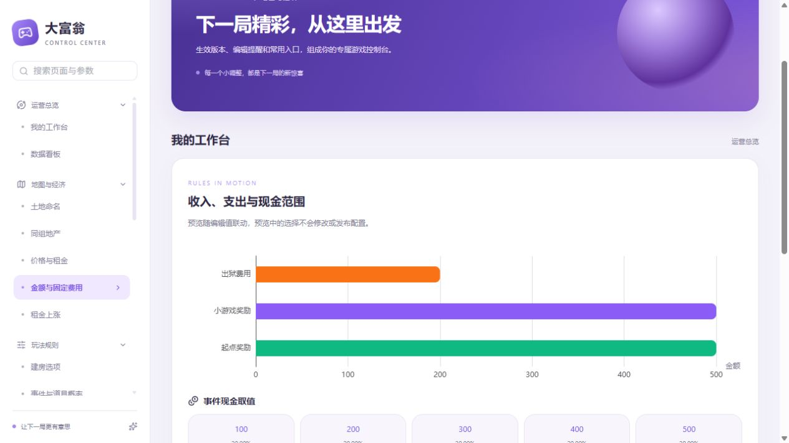
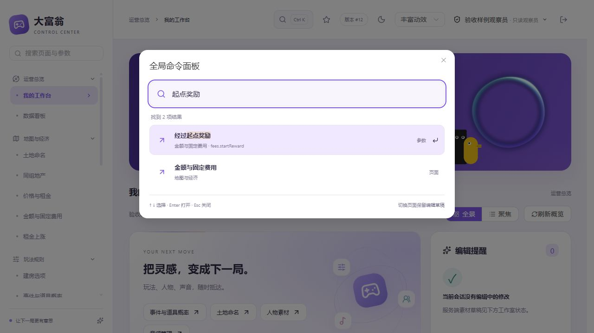

# 工作台与全局命令面板交付记录

2026-10-14。方案：[我的工作台与全局命令面板](../../ui/admin-workbench-v1/方案.md)。

## 实现

- 新登录首页“我的工作台”，完整数据看板仍单独保留。
- 全景/聚焦布局、彩光轨道、三色工作室卡片、数字递增、每日对局柱形入场、卡片光斑和轻倾斜、收藏排序动效。
- 玩法/人物/声音生效版本独立读取，错误独立显示和重试；当前会话修改与服务端素材草稿分别显示。刷新生效版本不替换编辑草稿，若玩法版本与编辑区不同则提醒。
- 收藏最多12项，前后移动排序，最近访问保留8项，主页显示5项。按后台用户ID保存在 localStorage，仅保存页面ID及布局，不含令牌或业务配置。
- Ctrl+K / Command+K命令面板，页面、参数名称与路径搜索、高亮、键盘选择、字段定位、主题/动效安全快捷操作。打开已有确认弹窗时避免抢焦点。
- 收藏、最近访问、页面、搜索结果均按权限过滤；只读观察员人物/音频使用 published 接口，不请求草稿。401/403沿用既有会话处理。
- 手机单列布局与现有减少动态效果偏好；隐藏页暂停轨道循环。源码与 gateway 静态构建产物同时交付，无服务端或迁移改动。

## 验证边界

- 本批独立源码快照（原HEAD加工作台/命令面板改动）：`npm test` 35项通过；`npm run build`成功；`git diff --cached --check`通过。工作区“体验与互动”页面的未完成改动保留，未混入本批暂存及前端构建。
- 页面交互验收使用只读静态接口样例，无数据库、对象存储、真实账号或发布操作。样例脚本位于忽略目录 tmp，不交付到运行服务。
- 已检查 Ctrl+K、中文参数搜索、高亮、Enter定位编辑字段、只读页面定位、Esc关闭、主题切换、收藏增减/排序、布局切换、数值按钮修改跨页保留、账号偏好隔离、观察员系统页面隐藏及草稿状态隐藏、390px手机布局无横向溢出、控制台无错误。
- 初始内存后端账号初始化脚本被自动审批拒绝，包含新建角色账号、改密及音频发布；该脚本没有执行成功。验收改为静态样例，不把页面验收描述成真实账号/真实后端联调。
- 不涉及微信真机、生产数据、云存储和发布；按用户“其他几项都是测试，先放放”的要求，本批不开展这些测试。
- 所有下方截图均为实际前端的静态接口验收样例，数字、人物数量和版本号不代表生产数据。

## 截图

按最近的用户指示只在本地提交，由用户自行推送。临时页面、进程和端口在验收后关闭。

共享仓库收尾期间，另一开发任务提交了 `3bf9dd2`，该提交包含本批此前已暂存的工作台主体及该任务的道具预览代码。保留共享提交历史，本批随后仅补交最终截图、命令面板简化动效修复、样式及对应构建产物，不重写另一任务提交。
