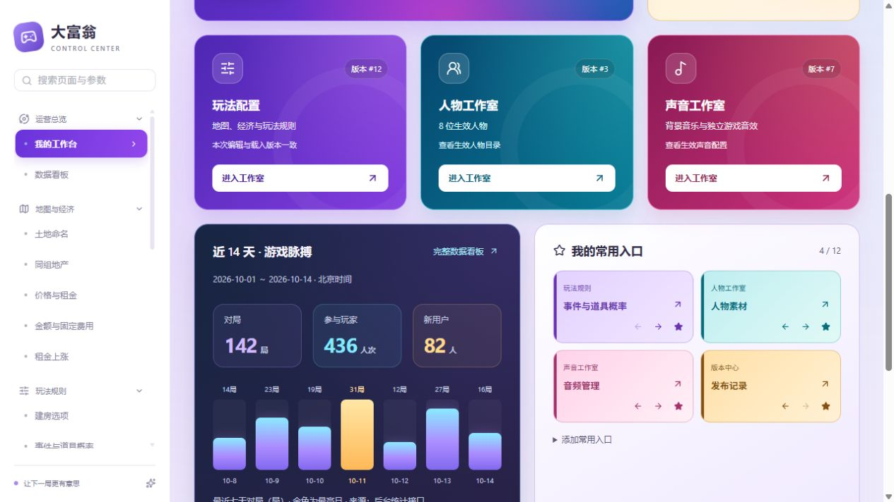
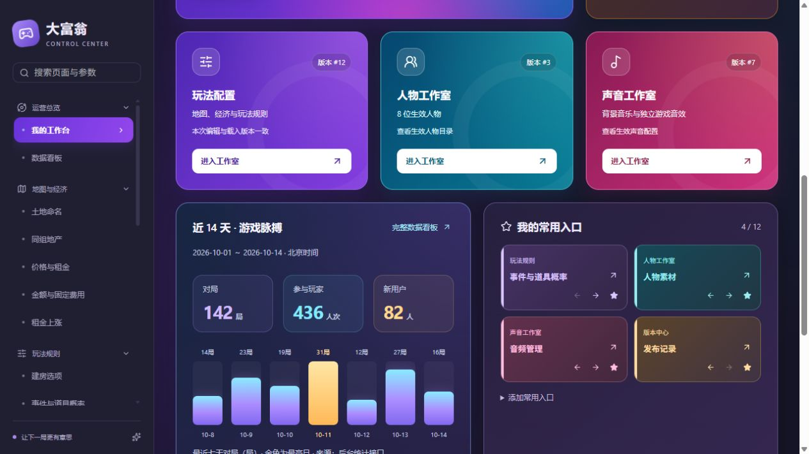
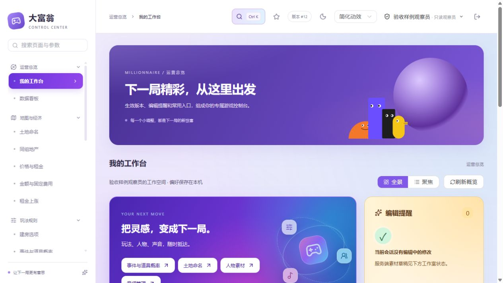

# 彩光工作台配色修订验收

2026-10-14。用户反馈“颜色太素了”，配色修订已落实到现有 Vue 工作台。[配色方案](../../ui/admin-workbench-v2/配色方案.md)。

配色独立前端快照及当前工作区均已运行 `npm run build`成功，实际 gateway 静态目录已更新；保留工作区另一组体验功能的未提交改动。页面检查使用只读静态接口样例，无真实账号、数据库、云存储或发布操作。所有截图中的统计、版本号与人物数量均为验收样例，不代表生产数据。

已检查三张工作室卡片实际渐变背景、浅色/深色文字颜色、收藏模块配色、最高日金色标记、390px手机布局和三个指标框无横向溢出、控制台无错误或警告。纯视觉修改不新增重复实现的测试，原交互逻辑沿用已验证实现。

按用户最新指示，本批仅本地提交，由用户自行推送。提交采用经过页面验收的独立配色构建，工作区另一组体验功能改动保留。临时标签页已关闭，验收服务进程已结束。旧版工作台截图保留在原交付目录。
