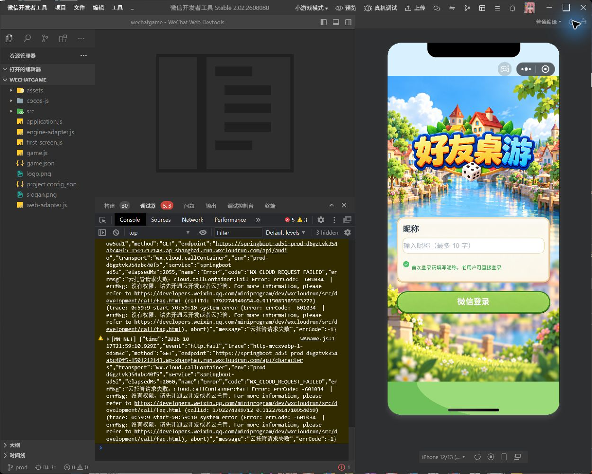

# 微信云通道本机联调

日期：2026-10-18。用户明确授权操作 Cocos、微信开发者工具及现有浏览器配置页，持续测试，仅在需要账号/权限时通知。

## 实际操作与结果

- 在用户当前的 Cocos Creator 3.8.8 构建窗口，对微信小游戏 wechatgame 执行“重新构建”，页面显示成功，最新构建时间 00:53:49。
- 在微信开发者工具确认实际项目目录为 `F:/work/millionnaire/client/build/wechatgame`，AppID 为 `wx52ae018677bc4829`，基础库 3.17.4。
- 构建后再次执行普通编译，00:59:08 发起 `callContainer`，00:59:10 对 `/api/characters` 和 `/api/audio` 均稳定返回权限错误。
- 直接读取开发者工具 Console 的原始诊断：内层错误 `errCode: -601034`，说明“没有权限，请先开通云开发或者云托管”。外层 SDK `errCode:-1` 不代表内层具体原因。
- 目标环境 `prod-d6gztvk354abc40f5`、服务 `springboot-ad5i`，日志 `transport=wx.cloud.callContainer`。调用能力存在、初始化已返回，但目标云请求被权限检查拒绝。
- 构建时工具自动刷新曾产生旧引擎散列文件的 ENOENT；没有将其当作云权限根因，已等构建成功后再普通编译复核权限错误。

## 当前结论及用户所需动作

已确认当前阻塞为小游戏 AppID 的云开发/云托管访问权限。仅凭平台报错，不能区分“该 AppID 尚未开通”与“已有环境属于其他 AppID、当前小游戏未关联或未授权”。

需要用户在云托管控制台核对上述 AppID 的开通状态及目标环境关联；若资源属于另一个小程序/公众号，核对资源复用/关联授权。是否需要共享资源方的 Cloud 实例初始化，需看到实际关联方式后再决定。尚未修改环境标识、服务名或身份鉴权来猜测修复。

## 浏览器访问边界

浏览器工具分别拒绝读取 `mp.weixin.qq.com` 和 `cloud.weixin.qq.com`：站点安全策略拦截，未触发用户授权提示或自动审批。没有通过原生浏览器、隐藏接口、其他浏览器表面或终端请求绕过读取这两个控制台。其开通与关联状态尚未核实，需用户处理或提供必要信息。

本次没有修改云权限、发布服务、上传小游戏或推送 Git。保留调试现场，待权限确认后继续登录和长连接验收。

## 证据

