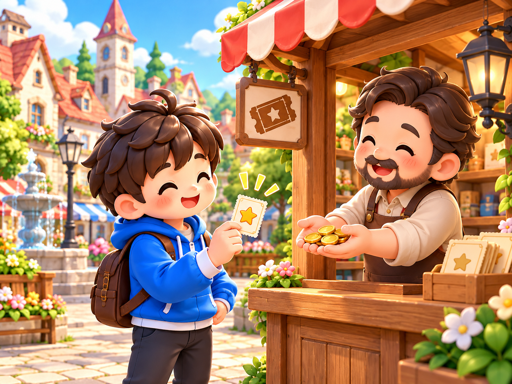
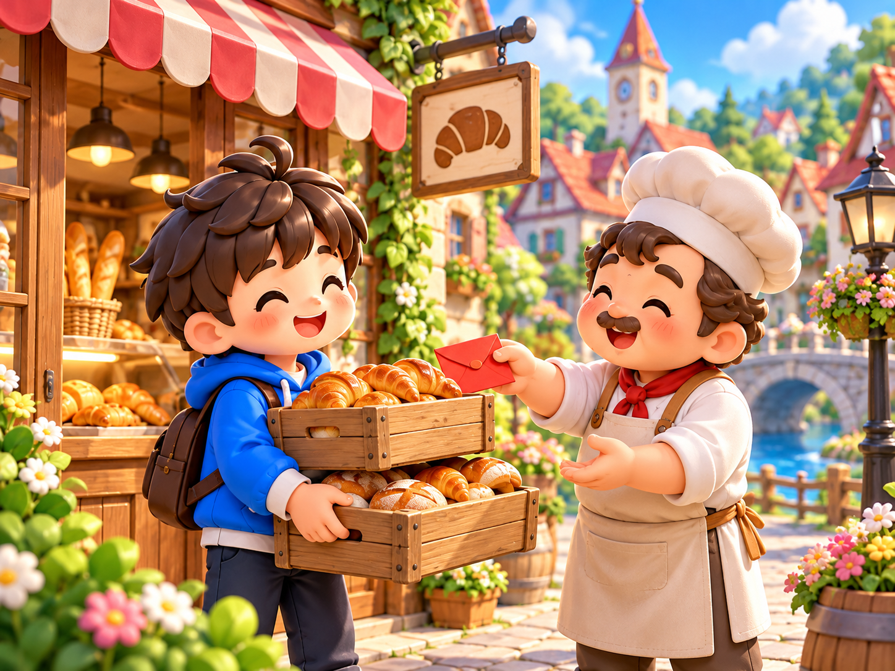
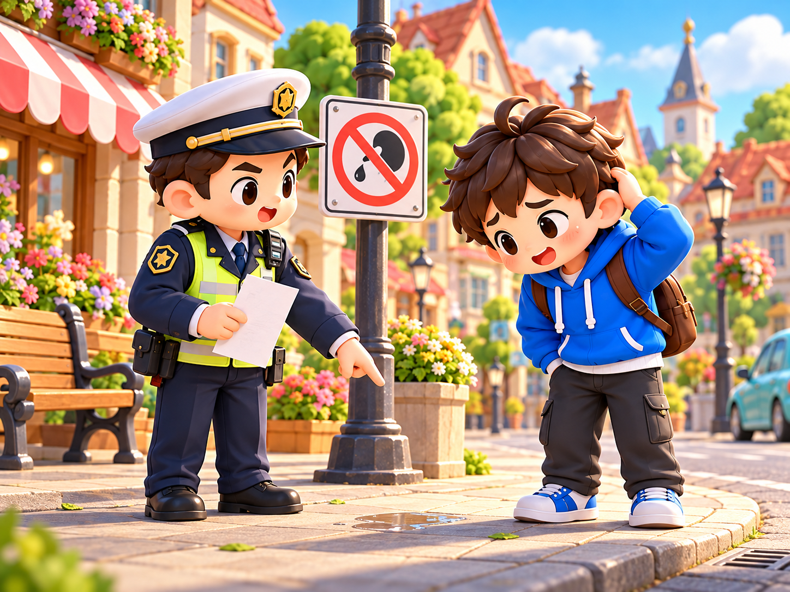
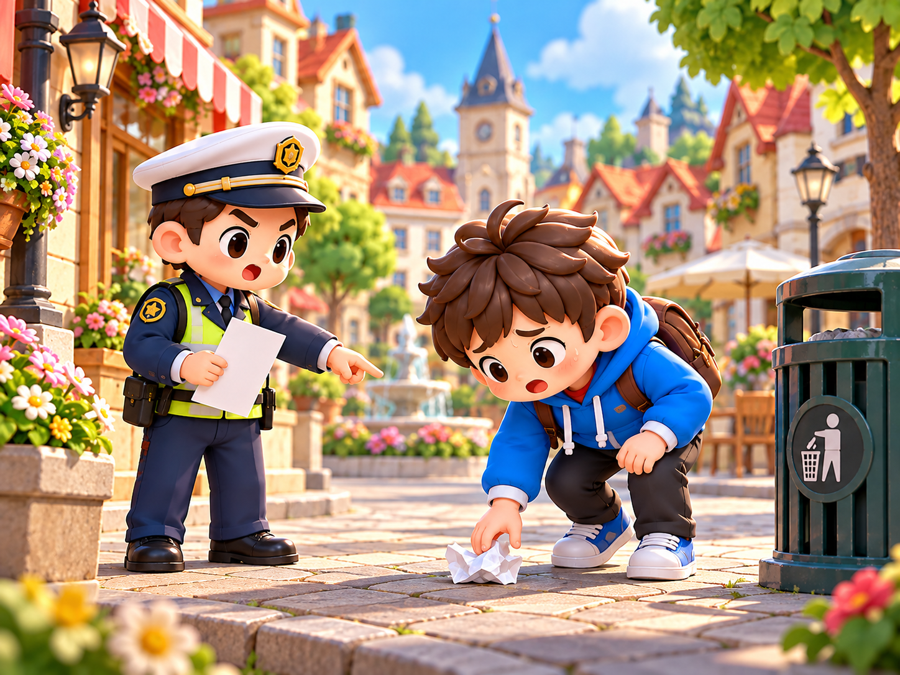
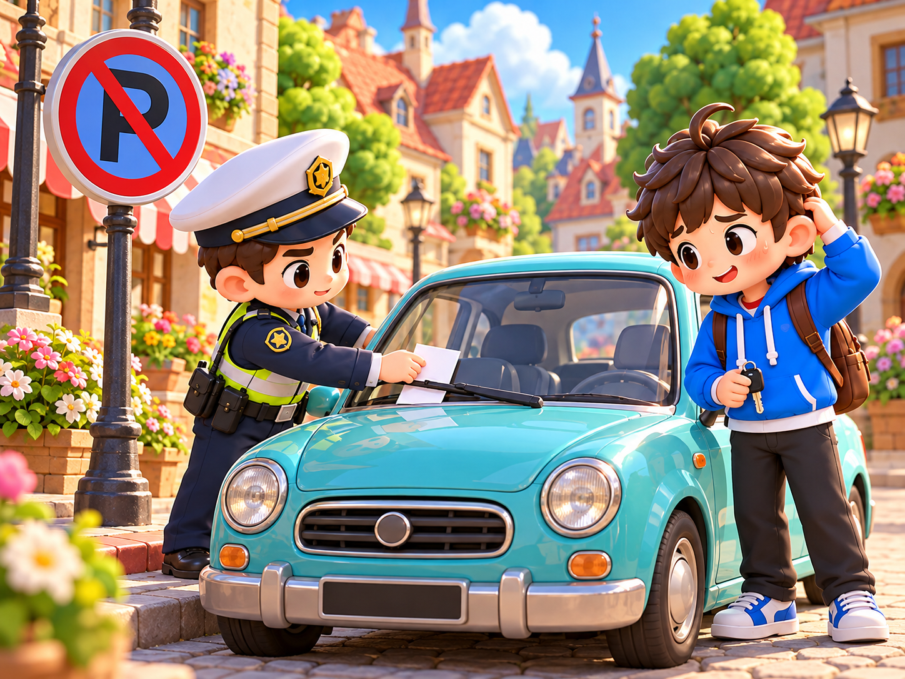
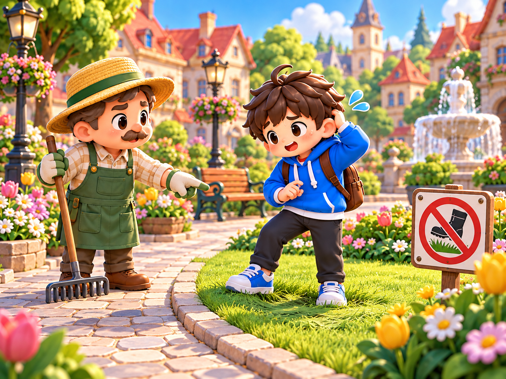
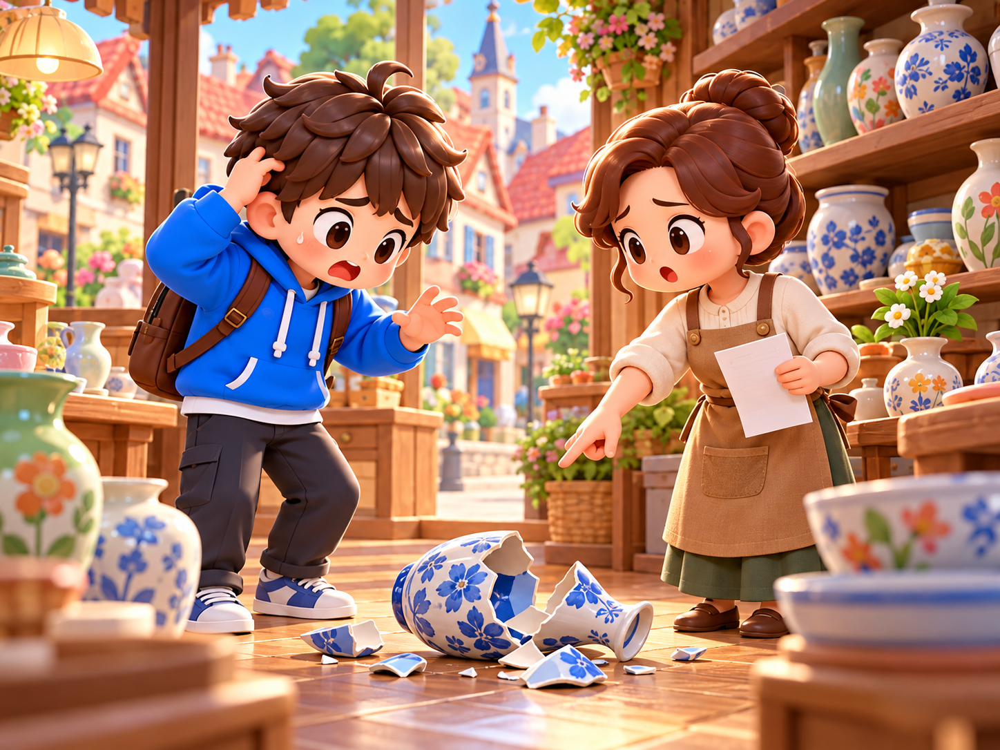

# 事件故事独立插画审阅

2026-10-19。情景卡布局已采用；以下 16 张新插画待逐张审阅，尚未接入运行界面。图片不含动态标题和金额。

[素材说明](../../assets-event-stories-v1/README.md) · [完整提示词](../../assets-event-stories-v1/prompts.md) · [机器可读清单与校验](../../assets-event-stories-v1/MANIFEST.json)

## 奖励事件

### 扶老过街

扶老奶奶过马路，好心有好报

`reward-01-help-elderly`

### 拾金不昧

捡到钱包交还失主，获得酬谢

`reward-02-return-wallet`

### 义务植树

参加社区义务植树，获得奖励

`reward-03-plant-tree`

### 征文获奖

小镇征文比赛获奖

`reward-04-writing-prize`

### 找回小狗

帮邻居找回走失的小狗

`reward-05-find-dog`

### 街头义演

街头义演收到打赏

`reward-06-street-performance`

### 幸运中奖

买彩票中了小奖

`reward-07-lottery-prize`

### 搬货帮忙

帮面包店搬货，老板发了红包

`reward-08-bakery-help`

## 扣款事件

### 随地吐痰

随地吐痰，被罚款

`fine-01-spitting`

### 闯红灯

闯红灯被交警拦下

`fine-02-red-light`

### 乱扔垃圾

乱扔垃圾被城管发现

`fine-03-littering`

### 深夜喧哗

深夜喧哗被邻居投诉

`fine-04-night-noise`

### 违章停车

违章停车被贴罚单

`fine-05-illegal-parking`

### 踩踏草坪

在公园踩踏草坪

`fine-06-lawn-damage`

### 图书逾期

图书馆的书逾期未还

`fine-07-overdue-book`

### 打碎花瓶

不小心打碎了商店的花瓶

`fine-08-broken-vase`

