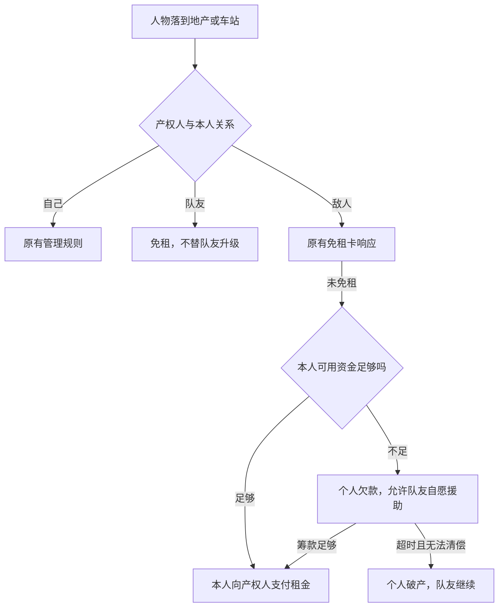

# 组队合作方案 v1

日期：2026-10-10。代码检查基线：0cd3909。

用户已确认资金方式：**个人资金和土地独立，队友免租，可互相援助**，并采用34–36号UI布局。以下为规则与实现方案；分队基础已完成，完整组队玩法尚未开放。

同日实施进度：已完成组队参数基础及管理后台编辑，实际组队对局尚未实现。见[实施记录](../../records/team-coop-implementation-2026-10-10.md)；后续分队、免租、援助和UI按本方案继续。

2026-10-11进度：服务端分队、开局锁定、交替顺序、快照/回放和客户端协议已完成，见[分队实施记录](../../records/team-coop-lobby-2026-10-11.md)。免租、援助、队伍终局、战绩及游戏UI仍待接入。

## 玩法定位

每个人独立买地、升级、收租和持牌，同队之间免租，可以自愿转钱救助队友；对敌队正常收租。最后按队伍判定胜负。

这不是公共账户或共同产权：可可买的土地仍属于可可，队友不能直接花她的钱、抵押她的土地或替她升级。帮助队友购买时，先转钱给购买人，再由购买人完成购买。

组队改变一局中的合作关系，系列赛累计多局积分。建议首版完成组队单局，与当前个人系列赛互斥；后续组队系列需要单独做队伍积分。

## 推荐规则

### 建房和回合

- 建房选择“个人对战 / 组队合作”，默认个人对战。首版建议两队，支持2v2、3v3、4v4；30格支持2v2，50格支持全部形式，并校验地图人数限制。三队、四队及人数不等暂不纳入首版。
- 真人自己选择队伍；房主可调整机器人队伍。真人换队需要本人确认。改成员、队伍或玩法设置清除准备，全员入队、两队人数相等且全部准备才可开始。
- 可以两名好友同队，对抗两个机器人。后台控制组队开关、开放形式及允许机器人，并遵守现有全局机器人开关。
- 开局锁定队伍、成员和玩法；掉线重连恢复原身份。建议行动交替两队，如蓝1→红1→蓝2→红2，顺序开局固定并记入回放。
- 投骰、移动、监狱和托管仍按人物执行。“一轮”沿用现有完整轮次定义，不另用两队行动次数计算月度奖励或租金上涨。

### 个人经济与队友免租

- 每个人使用房间配置的单人初始资金，购买款、升级费、租金、罚款及奖励全部进入对应个人账本。土地和车站继续记录个人产权。
- 落到自己的土地按原规则；落到队友土地或车站免租，不扣钱、不弹免租卡响应、不耗免租卡，也不能直接替队友升级。
- 落到敌人土地正常付给实际产权人。站点数量、同组地产加成仍按该产权人资产计算，不把队友资产合并计算。
- 事件前进/后退、快车、定点移动和正常投骰都经过统一落地结算；队友免租与敌人收租不能只覆盖一种移动方式。
- 银行、监狱、小游戏和系统罚款不受队友免租影响。抵押免租、租金上涨、城市事件等已有规则继续适用。
- 队伍净资产=存活成员个人净资产之和，各人沿用现有净资产公式，抵押本金只扣一次。棋盘保留各人现金，队伍汇总不能当作个人可支配金额。

### 自愿资金援助

建议两个入口，转账不收手续费：

1. **主动援助**：本人回合投骰前或落点处理完的合法用牌阶段，打开队友详情选择金额并确认。普通入口不在抽卡、拍卖、交易、债务或结算中开放。
2. **欠款求助**：当前人物欠款时显示缺口和“向队友求助”。存活队友在这个债务窗口自愿转入；按现有流程检查能否清偿，不能跳过欠款验证。

约束：

- 只能给同队存活成员，拒绝给自己、敌人、退出或破产成员。钱立即归收款人，不是贷款，不产生自动还款债务。
- 只能用未冻结的可用现金，不自动替出资人抵押资产；不能超过后台单笔上限及本人可用现金。整数游戏币，禁止零、负数和溢出。
- 主动援助受后台本人回合次数限制，首版建议每回合1次。欠款援助按债务ID、缺口及既有倒计时限制，反复求助不能无限延长回合。
- 欠款援助最多补到实时缺口。多人同时提交由服务器依次处理，后一笔超过剩余缺口拒绝并返回新金额，不能静默多扣或由客户端自行裁剪。
- 现有引擎有直接破产路径。开启欠款援助时，必须在不可逆清算前提供一次有时限的机会，到期恢复原欠款/清算流程。清算后不能靠晚到转账复活。
- 不自动转走真人或机器人的钱。机器人默认不主动援助，首版保留既有托管策略；机器人援助策略另行设计和配置。
- 每笔写双方账本和日志，如“阿杰援助可可300”，双方上方显示−300、+300。请求重试只记账一次，断线恢复后可追溯。
- 转出和转入都不计累计玩法收入、月度奖励基数、收租称号或收入排行，避免互转刷奖励；队伍净资产在转账前后不变。

### 道具、交易与拍卖

- 手牌、上限、免租/出狱卡和响应窗口仍归个人，首版不共享或赠牌。
- 建造、抵押、赎回只能操作本人地产。降级、拆楼、清地、强制购买等攻击禁止选队友资产，拒绝时不耗卡；查询手牌等敌方目标技能也校验阵营。
- 保护、拒绝购买仍由实际产权人响应，不新增队长代用队友手牌。
- 路障建议队友可通过，后台配置并在玩法说明显示。位置移动等人物目标道具逐项审计，不只给土地攻击加阵营判断。
- 拍卖各人竞价、冻结各自资金，资产归出价人；队友可各自参拍，不共用余额或竞价身份。
- 交易仍个人成交，允许与队友交易，但遵守现有价格、冻结和时机限制；土地不因队伍关系免费转移。援助不能绕过冻结，交易收入继续排除奖励基数。

### 破产、退出和胜负

- 个人欠款由本人处理，队友可以救助但没有出资义务。无法清偿则该人物破产，资产按现有清算处理，**不自动送给队友**。
- 一人破产或退出，队友继续；掉线沿用托管/重连。不能直接使用旧“只剩一个人”结束判断，否则同队多人存活时无法正确结束。
- 一队全员淘汰则该队出局；只剩一队有存活人物则获胜。限时按队伍净资产排序，相同同名次。破产成员仍展示队伍和个人结果，但清算后的资产不参与存活队伍汇总。
- 主动退出沿用个人资产处置，不能免费交地给队友；交接要在合法回合通过交易完成。退出确认说明队友仍会继续。
- 全员挂机/托管终局继续按人物和现有配置执行，结束原因单独显示。
- 战绩展示队伍胜负、成员名单和个人现金/净资产；不把队伍总资产重复写给每个人。

### 已有奖励和事件

- 指定轮次奖励仍按各人的累计玩法收入、比例与封顶分别到账；不合并成员收入再次奖励，援助款排除。
- 城市事件及租金递增作用于个人地产；队友免租优先于敌方租金倍率。事件、动画和援助/欠款窗口结束后再启动下一人投骰倒计时。
- 现有趣味称号保留个人动作/收入事实，首版不新增未评审称号。

## UI先出34号候选稿

本文件是规则和页面需求。2026-10-10已按用户要求生成34–36号候选稿，覆盖九个状态，见[图稿说明](README.md)；用户已采用布局，尚未接入。参考08房间、18资产、33结算及01棋盘，实施时复用既有独立素材。

- 房间：玩法切换、两队成员区、换队/机器人分队、准备及开局锁定。
- 棋盘：个人头像队伍标记，个人现金保留；汇总明确标为“队伍净资产”。
- 队友详情：显示这个人的人物、个人资金与土地，增加队友标签及合法时机的援助入口；自己/敌人不显示。
- 援助确认：收款人、可用资金、金额、确认/取消；冻结款和超额原因。
- 欠款：实时缺口、剩余时间、队友求助及援助结果；全员看到正在处理，不误开下一回合。
- 土地：实际产权人、队伍标记、当前等级；队友显示免租，保留真实租金档位说明。
- 结算：队伍排名在前，个人资产/称号在后；战绩标明组队。

不把整页截图当运行背景，不拼未经批准的新美术。尚未发现必须新增场景插画，候选稿确需素材时单独提出。

## 实现方式和代码影响

沿用**Cocos Creator3.8.8客户端、Java21引擎/网关、Vue管理后台**，不另建Vue游戏页面。

源码中OwnableState.owner、Ledger、EconomyModule.netWorth以个人为主体，可保留。租金、费用来源、道具、终局、奖励和排名需要适配。EconomyModule债务命令目前只允许债务人，且存在DIRECT_BANKRUPTCY；援助要新增合法命令，不能开放债务人的全部权限给队友。

1. **配置**：RuleConfig加TeamConfig，默认关闭。开放形式、允许机器人、队友免租、路障队友通行、援助开关/单笔上限/回合次数、欠款援助开关/等待时长均可配置。ConfigValidator校验；GameSettings/SettingsMapper补默认和中文校验；client config下发；web-manage编辑并提交static/admin构建产物。免租默认开启，关闭配置时必须明确展示。资金方向已经确定，不增加公共账户方案。
2. **状态**：TeamLobbyState与固定playerId→teamId映射。owner和账本仍用真实playerId；队伍、援助窗口/事件参加快照、回放和版本校验。
3. **阵营**：统一sameTeam、canAttackTarget、shouldChargeRent，在费用来源和响应窗口同步校验。车站和同组加成保留个人归属。
4. **援助**：TeamAid命令/事件，认证连接决定出资人，校验队伍、生命周期、窗口/债务ID、金额与可用资金。双方账本原子更新，幂等；队友只援助不能替抵押。GameProgress排除TEAM_AID，DebtState实时缺口衔接原流程。
5. **终局**：TurnModule改队伍结束条件，GameResult增加TeamStanding同时保留个人standings；个人清算仍由EconomyModule处理，一人破产不等于全队破产。
6. **协议/UI**：ChooseTeam、AssignBotTeam、TeamAid等请求，公开队伍及援助结果，私人手牌保持观察者过滤；服务器锁定开局队伍。等待前人动作和响应完成的倒计时约束保持。
7. **历史**：当前最新迁移V4，实施时复核并新增V5，不能改V1–V4。保存玩法、成员及队伍结果；旧配置缺项关闭，旧战绩按个人读；个人资产统计不重复汇总团队资产，沿用注销隐私处理。
8. **系列**：首版拒绝组队+个人系列；后续组队系列固定名册，按teamId记分一次，另外评审。

## 实施顺序和验收

1. 34–36号UI布局已获批准，按图稿说明约束实施，并记录玩法细则和可配置默认值。
2. 完成分队/锁定、阵营、免租及队伍终局。
3. 接入主动和欠款援助，处理冻结、直接破产、并发、奖励排除。
4. 接入道具、战绩/迁移、后台配置、Cocos和日志。
5. 完整回归后开启入口，开发时默认关闭。每批完成提交，不自行推送prod部署。

验证至少覆盖：各人数/地图、换队清准备/开局锁定/机器人；队友土地和站点免租不耗卡；敌方正常及事件移动收租；个人站点加成不串队；援助超额/冻结/敌方/淘汰拒绝、并发与幂等；清算前求助和超时后拒绝；援助不刷奖励；一人破产队友继续/整队淘汰/限时同分；普通单局、个人系列、道具、交易拍卖、断线、隐私、快照和回放；旧配置/历史及H2迁移。

实施后先server执行mvn install，再gateway执行mvn test；客户端严格类型检查/自检、Vue构建、Cocos真实4/6/8人验证。MySQL5.7及微信真机验证单独记录，源码/H2通过不能当上线验收。

方案阶段检查源码并编写文档；后续同日按用户要求生成34–36候选图。没有新增运行功能、配置或迁移，未运行玩法构建/测试。
